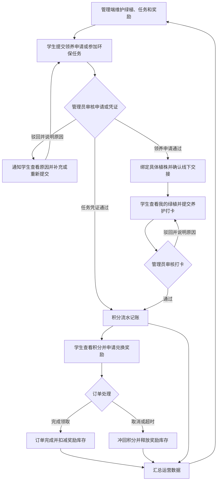

# 校园绿植领养与环保激励系统产品规划

本文将开题报告中的功能目标整理为可讨论、可设计的产品范围，并补上让学生端与管理端能够协同完成业务的必要规则。产品围绕一条主线展开：维护校园绿植和环保活动，组织学生参与，审核真实行动，发放可追溯的积分，完成奖励兑换，再用运营数据改进活动。整体划分为学生端、管理端和共用产品规则三类。本文讨论产品职责与业务流程，不展开 BFF、接口或数据库设计。

## 可直接用于页面设计的规格

本文是范围总览。页面入口、表单字段、按钮行为、状态变化和验收流程分别见：

- [管理端产品规格](product/admin.md)：工作台、绿植、领养、养护审核、环保任务、积分奖励、学生、资讯和统计。
- [学生端产品规格](product/student.md)：注册、领养、养护、任务、积分兑换、通知和反馈。
- [共用业务规则与状态定义](product/business-rules.md)：状态机、积分账本、库存、权限、通知和统计口径。

建议实现顺序：先做管理端资源和工作台，再做领养与交接、养护和任务审核、积分与兑换；随后接通学生端相应流程，最后按统一口径补齐统计。

## 1. 产品依据与范围边界

| 类型             | 内容                                                                                                                                                                                                                                              |
| ---------------- | ------------------------------------------------------------------------------------------------------------------------------------------------------------------------------------------------------------------------------------------------- |
| 开题报告明确提出 | 学生注册登录与个人中心；绿植信息管理、领养申请、审核绑定和养护档案；养护打卡；环保任务发布与材料审核；积分规则、发放、商品管理和兑换；学生与管理员管理；环保资讯；数据统计与 ECharts 展示。统计示例包括领养数量、参与人数、任务完成率和积分排行。 |
| 产品闭环补充建议 | 为具体植株记录唯一身份和状态；审核驳回时记录原因并通知学生；领养通过后确认线下交接；积分使用流水并防重复发放；兑换取消或超时后同步退回积分、释放库存；领养结束后确认植株归还或转入维护状态。                                                      |
| 暂不展开         | BFF 中间层、接口字段、数据库表结构、具体技术实现。                                                                                                                                                                                                |

开题报告指出的主要痛点是线下登记繁琐、养护监管缺失、环保成果难以量化、学生参与激励不足。产品设计需要逐项回应这些问题：线上记录替代纸面登记，打卡和审核支撑养护跟踪，统一统计口径量化参与结果，积分和奖励形成持续参与动力。

## 2. 学生与管理端的业务关系

图中“补充或重新提交”是闭环建议，是否允许、可重提次数和截止时间需要后续确定。环保任务与养护打卡都由管理员审核后进入积分账本；学生端显示审核状态和积分明细，管理端看到同一业务记录及处理结果。

## 3. 三类产品模块

### 3.1 学生端

| 模块             | 学生要完成的事                                                       | 首版建议                             |
| ---------------- | -------------------------------------------------------------------- | ------------------------------------ |
| 账号与个人中心   | 注册登录、维护资料，查看领养、打卡、任务、积分和兑换记录             | 必需                                 |
| 绿植发现与领养   | 浏览品种、位置和养护说明；提交申请；跟踪审核；确认领取并查看我的绿植 | 必需                                 |
| 日常养护         | 对已领养绿植提交带说明或照片的打卡，查看审核结果和积分               | 必需                                 |
| 环保任务         | 查看任务要求、时间和奖励，参与任务、提交完成凭证并跟踪审核           | 必需                                 |
| 积分与奖励       | 查看余额和流水，浏览奖励及库存，提交兑换并跟踪领取或取消结果         | 必需                                 |
| 消息通知         | 接收申请、打卡、任务、兑换和活动状态提醒                             | 必需的基础通知                       |
| 帮助、反馈与申诉 | 反馈植株异常、提交问题或对审核结果申诉                               | 可后续扩展；首版至少提供问题反馈入口 |

建议学生端主导航控制在：首页、绿植、任务、积分商城、我的。养护打卡放在“我的绿植”详情中，记录与通知收在“我的”中，避免把每个动作都做成独立主导航。

### 3.2 管理端

| 模块           | 管理员要完成的事                                                             | 首版建议                                       |
| -------------- | ---------------------------------------------------------------------------- | ---------------------------------------------- |
| 运营工作台     | 查看待审核事项、库存概况、活动参与和关键指标                                 | 必需；先用基础指标支撑日常处理                 |
| 绿植资源       | 维护品种、图片和养护说明；管理具体植株编号、位置及可领养、养护中、维护中状态 | 必需                                           |
| 领养关系       | 审核申请并记录原因；绑定具体植株；确认线下交接；登记领养结束和归还结果       | 必需                                           |
| 养护运营       | 查看并审核打卡、反馈原因、按规则确认积分；处理植株问题                       | 审核必需，问题维修流程可分期完善               |
| 环保任务       | 配置时间、名额、凭证要求和积分；发布任务并审核提交材料                       | 必需                                           |
| 积分与奖励     | 配置积分规则；查询流水；管理奖励和库存；处理兑换履约、取消和退款冲正         | 必需                                           |
| 学生管理       | 查看学生资料、账号状态及参与记录                                             | 必需的基础管理                                 |
| 资讯管理       | 创建、编辑和发布环保科普内容                                                 | 报告明确提出；积分是否与资讯阅读或互动关联待定 |
| 数据统计       | 查看领养数量、参与人数、任务完成率、积分排行及趋势                           | 必需的基础统计                                 |
| 通知与操作记录 | 通知申请人和待办管理员；保留审核、积分调整等关键操作记录                     | 通知必需；完整审计可分期完善                   |

管理端建议按日常工作划分导航：工作台、绿植资源、领养管理、养护审核、环保任务、积分与奖励、学生管理、资讯管理、问题反馈、数据统计。待审核、待履约等事项从工作台进入对应业务处理页。

### 3.3 学生端与管理端共用规则

| 规则       | 产品要求                                                                                                         |
| ---------- | ---------------------------------------------------------------------------------------------------------------- |
| 身份与权限 | 区分学生和管理员；学生只能处理自己的记录；管理员按职责查看和操作业务。开题报告提出两类角色，但细分权限尚未定义。 |
| 状态与审核 | 申请、打卡、任务提交和兑换订单都要有明确状态、处理人、处理时间和结果。学生与管理员看到同一状态。                 |
| 积分账本   | 每笔积分关联来源业务和审核结果；重复提交或重复审核不得重复发分；撤销、取消和人工调整都留下可核对的流水。         |
| 库存一致性 | 一盆具体绿植只能处于一个明确的领养或维护状态；奖励兑换需避免超卖。取消或超时要恢复相应库存。                     |
| 通知与反馈 | 关键状态变化通知相关学生；管理员能看到待办；驳回通知必须包含可理解的原因。                                       |
| 异常闭合   | 覆盖驳回、重复操作、库存不足、兑换取消或超时、领养结束和植株异常等情况。                                         |
| 统计口径   | 统一人数、申请量、完成量、完成率和积分统计的定义及统计周期，避免不同页面数字不一致。                             |

## 4. 核心业务状态建议

以下状态用于统一页面和流程设计，具体名称可以在原型阶段调整。

| 业务     | 建议状态流转                                            | 必须记录的结果                                           |
| -------- | ------------------------------------------------------- | -------------------------------------------------------- |
| 领养申请 | 待审核 → 已驳回，或待领取 → 领养中 → 已结束             | 驳回原因；绑定的具体植株；交接确认；结束和归还结果       |
| 养护打卡 | 待审核 → 已驳回，或已通过                               | 审核人、审核时间、反馈原因；通过后对应的积分流水         |
| 环保任务 | 草稿 → 已发布 → 已结束；学生凭证待审核 → 已驳回或已通过 | 任务要求、开放时间、名额、凭证、审核结果和积分流水       |
| 奖励兑换 | 待履约 → 已完成，或已取消 / 已超时                      | 兑换时的积分和库存变化；领取确认；取消或超时后的冲正记录 |
| 具体植株 | 可领养 → 待交接 → 养护中 → 维护中或可领养               | 植株编号、当前领养关系、位置、状态变化原因               |

养护打卡和环保任务的积分在审核通过后发放；资讯类及其他行为积分按另行确定的规则处理。奖励兑换的积分扣减时点、库存预留时点和订单超时规则，需要在产品规则确认后确定；无论采用哪种时点，取消和失败都应能准确恢复账目与库存。

## 5. 首版范围与后续扩展

### 首版应形成的完整闭环

1. 管理员可以维护绿植、环保任务、积分规则和奖励库存。
2. 学生可以注册登录、申请领养、查看状态，并知道何时完成线下交接。
3. 学生可以提交养护打卡和环保任务凭证，管理员可以审核并反馈处理结果。
4. 审核通过后，积分准确进入学生账户，学生可以查看来源和流水。
5. 学生可以兑换奖励；管理员能完成领取确认；取消或超时能冲回积分并释放库存。
6. 管理员可以结束领养关系并记录植株归还、维护或重新开放状态。
7. 学生端与管理端的状态、积分和库存一致；工作台能显示基础待办和统计数据。

### 可在首版稳定后扩展

- 学生自助申请转交、归还及管理员复核。
- 根据植株品种和季节生成养护计划与到期提醒。
- 植株病害、损坏、替换的工单化处理。
- 完整申诉流程、细粒度管理员角色、批量导入导出和审计报表。
- 更丰富的活动分析、趋势比较和运营效果评估。

## 6. 管理端优先设计顺序

结合先做管理端的安排，建议按业务依赖顺序设计：

1. **工作台**：确定待办入口和关键统计卡片，避免首页只展示数字却无法继续处理。
2. **绿植资源**：先定义品种与具体植株的区别、编号、位置和状态。
3. **领养管理**：串起申请审核、驳回原因、单株绑定、实物交接和关系结束。
4. **养护审核**：定义学生提交凭证、管理员审核、积分确认和驳回反馈。
5. **环保任务**：设计任务配置、学生提交、材料审核及积分发放。
6. **积分与奖励**：设计积分流水、兑换订单、履约、取消和库存恢复。
7. **学生与资讯管理**：补齐基础资料和内容运营。
8. **数据统计**：在业务定义稳定后确定指标口径和图表。

顺序先建立资源和状态，再落审核与积分，最后细化统计，减少后续因数据口径变化而重做页面。

## 7. 原型前需要确认的业务规则

页面和状态的首版默认行为已写入上述详细规格。实现前仍需由学校确认以下运营参数：

- 学校是否要求接入统一身份认证，或对学号真实性有额外核验要求。
- 每个品种的养护间隔、打卡积分数和环保任务的实际积分数值。
- 不同任务的开放时间、报名人数和凭证要求。
- 奖励库存、领取地点和领取期限；首版默认领取期限为 7 个自然日。
- 学生是否需要设置同时领养数量上限；首版默认不设总量上限。
- 若学校要求多级管理员，需补充角色及操作范围；首版使用单一管理员角色。
- 是否需要启用资讯积分；首版默认关闭，待计分行为明确后再开放。

其中资讯积分尤其需要确认：开题报告提到资讯管理，也在积分难点描述中提到资讯积分来源，但没有定义阅读、学习或互动的具体计分行为。首版将资讯作为内容管理模块，不自动发积分。

## 8. 产品完成判断

每条核心业务都应能回答四个问题：当前状态是什么、下一步由谁处理、处理结果如何通知、积分或库存是否同步变化。首版验收时应能从学生申请或参与开始，完整追踪到管理员处理、学生结果、积分流水和最终兑换；失败、驳回、取消或超时也要留下清晰结果，且不会造成重复发分或库存错误。
