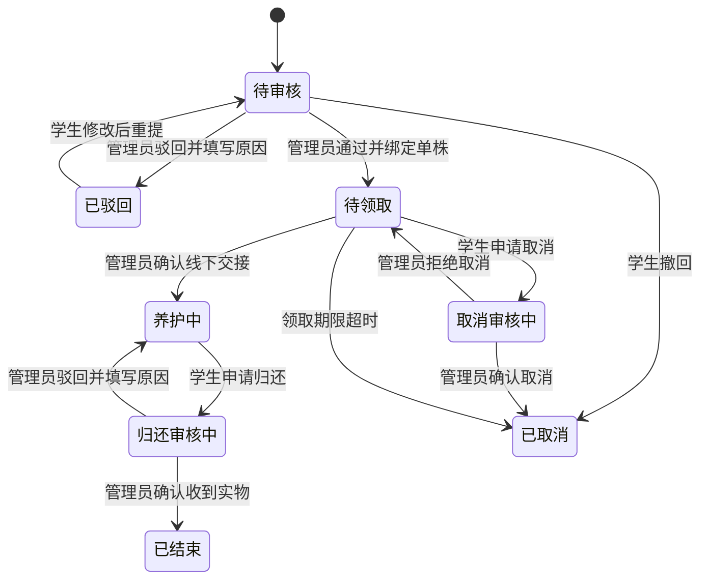

# 共用业务规则与状态定义

本文统一学生端和管理端共用的产品规则。页面文案、按钮可用性、数量统计和异常处理以本文为准；任何状态变化都必须能在两个端看到一致结果。

## 1. 首版推荐默认值

| 规则         | 首版默认                                                             | 说明                                                       |
| ------------ | -------------------------------------------------------------------- | ---------------------------------------------------------- |
| 用户角色     | 学生、管理员                                                         | 首版只有一个管理员角色；管理员账号预先配置，不开放自助注册 |
| 学生注册     | 学生自助填写资料，学号唯一；管理员可禁用账号                         | 不接入学校统一身份认证；真实身份校验方式由学校确认         |
| 领养数量     | 同一株只能绑定一个有效领养关系；同一学生对同一品种最多一条待审核申请 | 首版不设置学生可领养总量上限，后续可按学校规则增加         |
| 驳回后重提   | 允许修改后重提，保留每次提交和审核历史                               | 同一业务最终最多产生一笔有效积分                           |
| 养护频率     | 按品种配置养护间隔天数                                               | 到期前禁用打卡；配置项缺失时不能开放该品种的新领养         |
| 积分有效期   | 首版不设置过期                                                       | 所有获得、扣除、退回和人工调整都写流水                     |
| 资讯积分     | 首版关闭                                                             | 后续若开启，必须先定义可计分行为、频率限制和审核方式       |
| 奖励领取期限 | 商品可配置，默认 7 个自然日                                          | 到期未领取自动超时并退款、释放库存                         |
| 管理端列表   | 每页 10 条，创建时间倒序                                             | 所有列表统一分页与筛选行为                                 |

涉及校园认证、领取期限和数量限制的值可以由学校确认后调整；页面必须从配置展示当前规则，不能把数值分散硬编码在不同端。

## 2. 领养申请和植株状态

### 2.1 领养业务状态

### 2.2 植株状态

| 当前状态      | 可触发事件                   | 下一状态 | 负责角色    |
| ------------- | ---------------------------- | -------- | ----------- |
| 可领养        | 领养审核通过并绑定该株       | 待领取   | 管理员      |
| 待领取        | 确认交接                     | 养护中   | 管理员      |
| 待领取        | 申请取消获批或领取超时       | 可领养   | 管理员/系统 |
| 养护中        | 申请归还获批且植株可继续使用 | 可领养   | 管理员      |
| 养护中        | 申请归还获批但需检查或维修   | 维护中   | 管理员      |
| 维护中        | 维护完成                     | 可领养   | 管理员      |
| 可领养/维护中 | 停用                         | 已停用   | 管理员      |

任何时刻一株植物只能有一个当前有效领养关系。学生提交归还申请期间植株仍为养护中，不可再次分配。管理员确认已收到实物并选择处理方式后，才能释放或转入维护库存。

## 3. 养护打卡规则

1. 学生只能为自己当前“养护中”的单株提交打卡。
2. 需满足品种档案中的养护间隔；首次打卡以管理员确认交接时间为起点，后续以最近一次通过的打卡时间判断是否到期。
3. 文字说明或照片至少填写一项。提交后产生独立审核记录，状态为待审核。
4. 管理员通过后生成一条积分流水；驳回必须填写原因，学生可修正后重新提交。
5. 同一打卡审核重复触发、页面刷新或重试都不能重复发积分；纠错采用新冲正流水，不删除原记录。
6. 管理员若未配置对应积分规则，应先配置规则再通过打卡；打卡仍可驳回。

## 4. 环保任务规则

1. 任务只在开始时间到结束时间之间允许报名；已停用、未开始、已结束或名额已满时不能报名。
2. 同一学生同一任务只能创建一条参与记录；可在截止前提交凭证。
3. 任务至少要求文字说明或照片一种凭证；管理员发布时必须填写正整数奖励积分。
4. 管理员通过凭证后生成一条任务积分流水；驳回要求填写原因，学生可在截止前重提。
5. 任务结束后不接受新报名和新提交，但截止前已经提交的记录仍可审核。
6. 已有报名后，任务奖励积分、开始/结束时间和人数上限不可修改；需要调整时停用旧任务并新建任务。

## 5. 积分账本

积分余额只由流水汇总，不允许直接编辑余额。流水类型包括：养护打卡奖励、任务奖励、兑换扣减、兑换取消/超时退回、管理员增加、管理员扣减和纠错冲正。

每条流水必须包含学生、来源类型、来源业务编号、变动积分、变动后余额、发生时间和操作原因。审核通过后按配置生成奖励；同一来源业务编号只能有一条有效奖励流水。兑换退款必须关联原兑换流水。管理员人工扣分不得使余额低于 0，并必须填写原因。

资讯积分默认关闭；若将来启用，仍须使用积分规则设置单次积分和频率限制，并为每次发分记录可核对的资讯行为来源。

## 6. 奖励库存与订单规则

将商品库存拆分为可兑换、待领取占用、已领取三部分：

| 事件               | 可兑换库存 | 待领取占用 |     学生积分 |
| ------------------ | ---------: | ---------: | -----------: |
| 兑换成功           |         -1 |         +1 | 扣减商品积分 |
| 管理员确认领取     |       不变 |         -1 |         不变 |
| 学生取消待领取订单 |         +1 |         -1 | 退回商品积分 |
| 订单超时           |         +1 |         -1 | 退回商品积分 |

兑换提交必须同时检查积分余额和可兑换库存。订单创建、积分扣减、库存占用作为一次业务结果；任一条件不满足都不生成订单。取消和超时只能处理“待领取”订单，且同一订单最多恢复一次积分和库存。商品下架不影响已创建订单。

## 7. 状态通知规则

| 事件               | 通知对象    | 通知内容要点                       |
| ------------------ | ----------- | ---------------------------------- |
| 领养申请提交       | 管理员      | 学生、品种、提交时间、待审核入口   |
| 领养通过/驳回      | 学生        | 状态、植株/领取信息或驳回原因      |
| 取消申请处理结果   | 学生        | 已取消，或取消未通过及原因         |
| 领养交接确认       | 学生        | 领养已开始、植株和养护入口         |
| 归还申请/处理结果  | 管理员/学生 | 待处理事项或归还结果、原因         |
| 打卡/任务凭证提交  | 管理员      | 待审核记录入口                     |
| 打卡/任务审核结果  | 学生        | 通过或驳回原因、积分变化           |
| 兑换成功           | 学生        | 商品、扣除积分、领取地点和截止时间 |
| 兑换领取/取消/超时 | 学生        | 订单结果及积分退回情况             |
| 账号禁用           | 学生        | 账号受限提示和联系管理员方式       |

站内通知为首版必需；短信、邮件、推送等外部渠道不属于首版范围。通知点击后应打开对应业务详情。

## 8. 管理权限与操作记录

首版只有学生和管理员两种角色。学生仅能查看和操作自己的资料及业务；管理员可以查看和处理全校业务。管理员每次审核、积分调整、库存状态修改、账号禁用和订单取消都记录操作人、时间、对象、前后状态和原因。已完成业务不做物理删除。

## 9. 统计口径

| 名称         | 口径                                                                         |
| ------------ | ---------------------------------------------------------------------------- |
| 当前在养绿植 | 当前单株状态为养护中的植株数                                                 |
| 累计领养数   | 指定时间内由待领取转为养护中的领养关系数                                     |
| 参与学生数   | 指定时间内至少有一次审核通过的打卡或任务凭证的去重学生数                     |
| 任务完成率   | 已通过凭证人数 ÷ 已报名且任务已结束的参与人数；分母为 0 显示“—”              |
| 当前积分排行 | 按当前积分余额排序；同分按最近获得积分时间排序                               |
| 积分发放量   | 时间范围内打卡和任务通过产生的奖励积分之和；兑换退回、人工调整和冲正另行统计 |
| 可领养库存   | 当前单株状态为可领养的数量                                                   |

所有图表统一使用选择的时间范围和校园时区；“当前库存/余额”是当前快照，“累计/趋势”按业务发生时间过滤。

## 10. 核心失败处理

- **库存刚被占用：** 提交领养或兑换时重新检查库存；失败则保留页面数据并提示刷新，不产生半完成记录。
- **重复点击：** 审核、兑换、取消和确认领取按钮提交后进入处理中，服务端重复请求按同一业务结果处理。
- **积分不足：** 不创建兑换订单，展示当前余额和所需积分。
- **审核驳回：** 必须说明原因；学生端展示原因和可重提入口。
- **订单取消/超时：** 只有待领取订单能取消或超时；积分与库存恢复一次并有原订单关联记录。
- **学生账号禁用：** 禁止新建业务；保留已有业务、通知和待履约订单供管理员继续处理。
